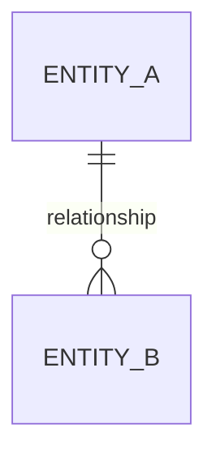

# Software Requirements Specification

## Table Of Contents

- [0. Document Control](#0-document-control)
  - [0.1 Document Information](#01-document-information)
  - [0.2 Revision History](#02-revision-history)
  - [0.3 Review And Approval](#03-review-and-approval)
- [1. Introduction](#1-introduction)
  - [1.1 Purpose](#11-purpose)
  - [1.2 Scope](#12-scope)
    - [1.2.1 In Scope](#121-in-scope)
    - [1.2.2 Out Of Scope](#122-out-of-scope)
    - [1.2.3 Future Scope](#123-future-scope)
  - [1.3 Intended Audience](#13-intended-audience)
  - [1.4 Definitions, Acronyms And Abbreviations](#14-definitions-acronyms-and-abbreviations)
  - [1.5 References](#15-references)
  - [1.6 Document Overview](#16-document-overview)
- [2. Overall Description](#2-overall-description)
  - [2.1 Product Perspective](#21-product-perspective)
    - [2.1.1 System Boundary](#211-system-boundary)
    - [2.1.2 Context Diagram](#212-context-diagram)
  - [2.2 Product Functions](#22-product-functions)
  - [2.3 User Classes And Characteristics](#23-user-classes-and-characteristics)
  - [2.4 Operating Environment](#24-operating-environment)
  - [2.5 Design And Implementation Constraints](#25-design-and-implementation-constraints)
  - [2.6 Assumptions And Dependencies](#26-assumptions-and-dependencies)
- [3. Stakeholders, Actors And External Systems](#3-stakeholders-actors-and-external-systems)
  - [3.1 Stakeholders](#31-stakeholders)
  - [3.2 Actors](#32-actors)
  - [3.3 Actor Permission Overview](#33-actor-permission-overview)
  - [3.4 External Systems](#34-external-systems)
- [4. Business Context](#4-business-context)
  - [4.1 Problem Statement](#41-problem-statement)
  - [4.2 Business Goals](#42-business-goals)
  - [4.3 Success Criteria](#43-success-criteria)
  - [4.4 Current Workflow](#44-current-workflow)
  - [4.5 Target Workflow](#45-target-workflow)
- [5. Product Features](#5-product-features)
  - [5.1 Feature Map](#51-feature-map)
  - [5.2 Feature List (Only When No PRD Exists)](#52-feature-list-only-when-no-prd-exists)
- [6. Use Case Specifications](#6-use-case-specifications)
  - [6.1 Use Case Overview](#61-use-case-overview)
  - [6.2 Use Case Details](#62-use-case-details)
    - [UC-GEN-001 Use Case Name](#uc-gen-001-use-case-name)
- [7. Business Rules](#7-business-rules)
  - [7.1 Business Rule Catalogue](#71-business-rule-catalogue)
  - [7.2 Business Rule Details](#72-business-rule-details)
    - [BR-GEN-001 Rule Name](#br-gen-001-rule-name)
- [8. Functional Requirements](#8-functional-requirements)
  - [8.1 Functional Requirement Index](#81-functional-requirement-index)
  - [8.2 Functional Requirement Details](#82-functional-requirement-details)
    - [DOMAIN Requirements (Light Domain)](#domain-requirements-light-domain)
    - [FR-GEN-002 Requirement Name (Standard Or Strict Domain)](#fr-gen-002-requirement-name-standard-or-strict-domain)
- [9. Data Requirements And Data Model](#9-data-requirements-and-data-model)
  - [9.1 Modeling Scope](#91-modeling-scope)
  - [9.2 Conceptual Data Model](#92-conceptual-data-model)
  - [9.3 Entity Attributes](#93-entity-attributes)
  - [9.4 Data Constraints And Validation Rules](#94-data-constraints-and-validation-rules)
  - [9.5 Data Ownership And Source Of Truth](#95-data-ownership-and-source-of-truth)
  - [9.6 Data Lifecycle And Retention](#96-data-lifecycle-and-retention)
  - [9.7 Data Migration](#97-data-migration)
- [10. External Interface Requirements](#10-external-interface-requirements)
  - [10.1 User Interface Requirements](#101-user-interface-requirements)
  - [10.2 Software Interface Requirements](#102-software-interface-requirements)
  - [10.3 Hardware Interface Requirements](#103-hardware-interface-requirements)
  - [10.4 Communication Interface Requirements](#104-communication-interface-requirements)
- [11. Non-Functional Requirements](#11-non-functional-requirements)
  - [11.1 Non-Functional Requirement Catalogue](#111-non-functional-requirement-catalogue)
  - [11.2 Non-Functional Requirement Details](#112-non-functional-requirement-details)
    - [NFR-PERF-002 Requirement Name](#nfr-perf-002-requirement-name)
  - [11.3 Performance](#113-performance)
  - [11.4 Availability](#114-availability)
  - [11.5 Reliability](#115-reliability)
  - [11.6 Scalability](#116-scalability)
  - [11.7 Security](#117-security)
  - [11.8 Privacy](#118-privacy)
  - [11.9 Usability](#119-usability)
  - [11.10 Maintainability](#1110-maintainability)
  - [11.11 Compatibility And Portability](#1111-compatibility-and-portability)
  - [11.12 Accessibility](#1112-accessibility)
  - [11.13 Logging And Auditing](#1113-logging-and-auditing)
  - [11.14 Backup And Recovery](#1114-backup-and-recovery)
  - [11.15 Compliance](#1115-compliance)
  - [11.16 Safety](#1116-safety)
- [12. Access Control Requirements](#12-access-control-requirements)
  - [12.1 Authentication Requirements](#121-authentication-requirements)
  - [12.2 Authorization Requirements](#122-authorization-requirements)
  - [12.3 Access Control Matrix](#123-access-control-matrix)
- [13. State Models](#13-state-models)
  - [13.1 State Definitions](#131-state-definitions)
  - [13.2 State Transitions](#132-state-transitions)
  - [13.3 State Diagram](#133-state-diagram)
- [14. Error Handling And Edge Cases](#14-error-handling-and-edge-cases)
  - [14.1 Error Catalogue](#141-error-catalogue)
  - [14.2 Edge Cases](#142-edge-cases)
- [15. Acceptance Criteria And Verification](#15-acceptance-criteria-and-verification)
  - [15.1 Acceptance Criteria Catalogue](#151-acceptance-criteria-catalogue)
  - [15.2 Verification Methods](#152-verification-methods)
- [16. Requirements Traceability](#16-requirements-traceability)
  - [16.1 Requirements Traceability Matrix](#161-requirements-traceability-matrix)
  - [16.2 Requirement Dependencies](#162-requirement-dependencies)
- [17. Open Questions, Decisions And Risks](#17-open-questions-decisions-and-risks)
  - [17.1 Open Questions](#171-open-questions)
  - [17.2 Decisions](#172-decisions)
  - [17.3 Requirement-Related Risks](#173-requirement-related-risks)
  - [17.4 Deferred To Design](#174-deferred-to-design)
- [18. Appendices](#18-appendices)
  - [18.1 Glossary](#181-glossary)
  - [18.2 Diagrams](#182-diagrams)
  - [18.3 Supporting Documents](#183-supporting-documents)
  - [18.4 Deprecated Items](#184-deprecated-items)
- [19. Requirement Identification Convention](#19-requirement-identification-convention)
  - [19.1 Domains And Rigor](#191-domains-and-rigor)
- [20. Requirement Status Convention](#20-requirement-status-convention)
- [21. SRS Review Checklist](#21-srs-review-checklist)
  - [21.1 Scope And Context](#211-scope-and-context)
  - [21.2 Requirements](#212-requirements)
  - [21.3 Coverage](#213-coverage)
  - [21.4 Traceability And Completion](#214-traceability-and-completion)
- [22. Approval](#22-approval)

## 0. Document Control

**Last Updated**: YYYY-MM-DD
**Status**: DRAFT
**Author**: Agent

### 0.1 Document Information

| Field | Value |
|---|---|
| Project Name | `<Project Name>` |
| Software/System Name | `<Software or System Name>` |
| Project Profile | PERSONAL / TEAM / SME |
| Tier | 1 / 2 / 3 |
| Upstream Documents | `<BRS / BRD / StRS / PRD with versions>`, or None (Discovery skipped, see `<DEC ID>`) |
| Document Name | Software Requirements Specification |
| Document ID | `<Document ID>` |
| Version | `0.1` |
| Status | `DRAFT` |
| Author | `<Author>` |
| Reviewer | `<Reviewer or Review Group>` |
| Approver | `<Approver>` |
| Created Date | `YYYY-MM-DD` |
| Last Updated | `YYYY-MM-DD` |

### 0.2 Revision History

| Version | Date | Author | Changed Sections | Change Description | Status |
|---|---|---|---|---|---|
| 0.1 | `YYYY-MM-DD` | Agent | Initial document | Initial draft | DRAFT |

### 0.3 Review And Approval

| Role | Name | Review Status | Review Date | Comments |
|---|---|---|---|---|
| Author | `<Name>` | DRAFT | `YYYY-MM-DD` | |
| Reviewer | `<Name or Group>` | REVIEW | | |
| Approver | `<Name or Role>` | REVIEW | | |

## 1. Introduction

**Last Updated**: YYYY-MM-DD
**Status**: DRAFT
**Author**: Agent

### 1.1 Purpose

`<Describe the purpose of this SRS, the software/system being specified, the applicable version, and how this document will be used.>`

### 1.2 Scope

`<Describe the system boundary, business scope, release scope, and what this SRS covers.>`

#### 1.2.1 In Scope

- `<Capability, process, data scope, or integration included in this release>`

#### 1.2.2 Out Of Scope

- `<Capability, process, data scope, or integration excluded from this release>`

#### 1.2.3 Future Scope

- `<Potential future capability not committed in this release>`

### 1.3 Intended Audience

| Audience | Purpose Of Reading | Relevant Sections |
|---|---|---|
| `<Audience or Role>` | `<How this audience uses the SRS>` | `<Sections>` |

### 1.4 Definitions, Acronyms And Abbreviations

| Term | Type | Definition | Source Or Notes |
|---|---|---|---|
| `<Term>` | Term / Acronym / Abbreviation | `<Definition>` | `<Source or context>` |

### 1.5 References

| Reference ID | Document Or Source | Version/Date | Owner | Location | Relevant Content |
|---|---|---|---|---|---|
| REF-GEN-001 | `<Business-layer document: BRS or BRD>` | `<Version>` | `<Owner>` | `<01-BRS.md or 01-BRD.md>` | Business goals, rules, constraints |
| REF-GEN-002 | `<Stakeholder/product-layer document: StRS or PRD>` | `<Version>` | `<Owner>` | `<02-StRS.md or 02-PRD.md>` | Users, needs, features, user stories |
| REF-GEN-003 | `<Reference Name>` | `<Version or Date>` | `<Owner>` | `<Link or Path>` | `<Relevant sections>` |

### 1.6 Document Overview

`<Summarize the structure and main contents of this SRS.>`

## 2. Overall Description

**Last Updated**: YYYY-MM-DD
**Status**: DRAFT
**Author**: Agent

### 2.1 Product Perspective

`<Describe the system position within its operational environment and its relationship to other systems or processes.>`

#### 2.1.1 System Boundary

`<Describe what is inside the system and what remains outside the system boundary.>`

#### 2.1.2 Context Diagram

`<Insert or reference the context diagram. Use Not Applicable with rationale if none is required.>`

### 2.2 Product Functions

| Function Group ID | Function Group | Description | Related Features |
|---|---|---|---|
| PF-GEN-001 | `<Function Group>` | `<High-level capability>` | `<Feature IDs>` |

### 2.3 User Classes And Characteristics

Reuse the `UCL` IDs from the StRS (Section 5.1) or PRD (Section 5) when one exists.

| User Class ID | User Class | Goals | Responsibilities | Technical Experience | Usage Frequency | Restrictions |
|---|---|---|---|---|---|---|
| UCL-GEN-001 | `<User Class>` | `<Goals>` | `<Responsibilities>` | `<Experience>` | `<Frequency>` | `<Restrictions>` |

### 2.4 Operating Environment

| Category | Requirement Or Environment |
|---|---|
| Application Type | `<Web, mobile, desktop, service, embedded, or other>` |
| Client Environment | `<Supported client environment>` |
| Server Environment | `<Required server environment>` |
| Network Environment | `<Network and connectivity requirements>` |
| Runtime Environment | `<Required runtime environment>` |
| Data Platform | `<Required data platform if constrained>` |
| Other | `<Other environmental requirements>` |

### 2.5 Design And Implementation Constraints

| Constraint ID | Constraint | Source | Rationale | Scope | Verification Method | Status |
|---|---|---|---|---|---|---|
| CON-GEN-001 | `<Mandatory constraint>` | `<Source ID>` | `<Reason>` | `<Affected scope>` | Test / Analysis / Inspection / Demonstration | DRAFT |

### 2.6 Assumptions And Dependencies

| ID | Type | Statement | Source | Impact If False Or Unavailable | Owner | Status |
|---|---|---|---|---|---|---|
| ASM-GEN-001 | Assumption | `<Assumption>` | `<Source ID or [ASSUMPTION]>` | `<Impact>` | `<Owner>` | DRAFT |
| DEP-GEN-001 | Dependency | `<Dependency>` | `<Source ID>` | `<Impact>` | `<Owner>` | DRAFT |

## 3. Stakeholders, Actors And External Systems

**Last Updated**: YYYY-MM-DD
**Status**: DRAFT
**Author**: Agent

### 3.1 Stakeholders

| Stakeholder ID | Stakeholder | Role | Interests | Decision Authority | Validation Responsibility | Status |
|---|---|---|---|---|---|---|
| STK-GEN-001 | `<Stakeholder>` | `<Role>` | `<Interests>` | `<Authority>` | `<Sections or requirements>` | DRAFT |

### 3.2 Actors

| Actor ID | Actor | Actor Type | Goal | Main Interactions | Access Conditions | Related User Class |
|---|---|---|---|---|---|---|
| ACT-GEN-001 | `<Actor>` | Human / System / Device | `<Goal>` | `<Interactions>` | `<Conditions>` | `<User Class ID>` |

### 3.3 Actor Permission Overview

| Actor Or Role | Resource | View | Create | Update | Delete | Approve | Configure | Data Scope |
|---|---|---:|---:|---:|---:|---:|---:|---|
| `<Actor or Role>` | `<Resource>` | Yes/No | Yes/No | Yes/No | Yes/No | Yes/No | Yes/No | `<Scope>` |

### 3.4 External Systems

| External System ID | System | Owner | Integration Purpose | Data Sent | Data Received | Interface | Availability Dependency |
|---|---|---|---|---|---|---|---|
| EXT-INTG-001 | `<External System>` | `<Owner>` | `<Purpose>` | `<Data>` | `<Data>` | `<Interface reference>` | `<Dependency>` |

## 4. Business Context

**Last Updated**: YYYY-MM-DD
**Status**: DRAFT
**Author**: Agent

When a BRS, BRD, or PRD owns these items, this section references them by ID (`BG`, `SC`, `BP`, `BR`) with at most a one-sentence summary each, and the tables in 4.2 and 4.3 are replaced by a list of references. Use the tables only when no upstream document owns the items. See `Agent/03-SRS/02-SRS Output Contract.md` Section 5.

### 4.1 Problem Statement

`<Describe the current problem, affected users or stakeholders, business context, and impact. Do not describe the technical solution here.>`

### 4.2 Business Goals

| Business Goal ID | Goal | Owner | Expected Outcome | Priority | Source | Status |
|---|---|---|---|---|---|---|
| BG-GEN-001 | `<Business Goal>` | `<Owner>` | `<Outcome>` | Must / Should / Could / Won't | `<Source ID>` | DRAFT |

### 4.3 Success Criteria

| Success Criterion ID | Related Goal | Metric | Target | Measurement Method | Evaluation Time | Owner |
|---|---|---|---|---|---|---|
| SC-GEN-001 | `<Business Goal ID>` | `<Metric>` | `<Target>` | `<Method>` | `<Time>` | `<Owner>` |

### 4.4 Current Workflow

| Step | Participant | Action | Input | Output | Issue Or Limitation |
|---:|---|---|---|---|---|
| 1 | `<Participant>` | `<Action>` | `<Input>` | `<Output>` | `<Issue>` |

### 4.5 Target Workflow

| Step | Actor/System | Action | Input | Business Rule | Output | Resulting State |
|---:|---|---|---|---|---|---|
| 1 | `<Actor or System>` | `<Action>` | `<Input>` | `<Business Rule ID>` | `<Output>` | `<State>` |

## 5. Product Features

**Last Updated**: YYYY-MM-DD
**Status**: DRAFT
**Author**: Agent

When a PRD exists, it owns the features. This section then contains only the Feature Map (5.1) and does not restate descriptions, priorities, personas, or goals (`Agent/03-SRS/02-SRS Output Contract.md` Section 5). When no PRD exists, the SRS owns the features and uses Section 5.2.

### 5.1 Feature Map

| Feature ID | Feature Name | Use Cases | Functional Requirements |
|---|---|---|---|
| F-GEN-001 | `<Feature Name>` | `<UC IDs or None>` | `<FR IDs>` |

### 5.2 Feature List (Only When No PRD Exists)

| Feature ID | Feature Name | Description | Primary Actor | Related Goal | Stakeholder Requirements | Priority | Release | Status |
|---|---|---|---|---|---|---|---|---|
| F-GEN-001 | `<Feature Name>` | `<Description>` | `<Actor ID>` | `<Business Goal ID>` | `<STR IDs>` | Must / Should / Could / Won't | `<Release>` | DRAFT |

## 6. Use Case Specifications

**Last Updated**: YYYY-MM-DD
**Status**: DRAFT
**Author**: Agent

### 6.1 Use Case Overview

| Use Case ID | Use Case Name | Primary Actor | Goal | Related Feature | Priority | Status |
|---|---|---|---|---|---|---|
| UC-GEN-001 | `<Use Case Name>` | `<Actor ID>` | `<Goal>` | `<Feature ID>` | Must / Should / Could / Won't | DRAFT |

### 6.2 Use Case Details

Write details at the depth required by the rigor level of the use case's domain (`Agent/03-SRS/02-SRS Output Contract.md` Section 2.2.3). Omit `Alternative Flows` or `Exception Flows` when there are none, instead of writing `None`.

#### UC-GEN-001 Use Case Name

| Attribute | Value |
|---|---|
| Goal | `<Actor goal>` |
| Primary Actor | `<Actor ID>` |
| Supporting Actors | `<Actor or external system IDs>` |
| Trigger | `<Trigger>` |
| Priority | Must / Should / Could / Won't |
| Status | DRAFT |

##### Preconditions

- `<Precondition>`

##### Main Flow

1. `<Actor or system action>`
2. `<Actor or system action>`

##### Alternative Flows

###### AF-GEN-001 Alternative Flow Name

- **Starts At**: Step `<Number>`
- **Condition**: `<Condition>`
- **Returns To**: Step `<Number>` / Ends use case

##### Exception Flows

###### EF-GEN-001 Exception Flow Name

- **Occurs At**: Step `<Number>`
- **Condition**: `<Failure condition>`
- **Resulting State**: `<State>`

##### Postconditions

- **Success**: `<Success postcondition>`
- **Failure**: `<Minimum guarantee after failure>`

##### Related Items

- **Business Rules**: `<Business Rule IDs or None>`
- **Requirements**: `<Requirement IDs or None>`

## 7. Business Rules

**Last Updated**: YYYY-MM-DD
**Status**: DRAFT
**Author**: Agent

### 7.1 Business Rule Catalogue

The catalogue holds the rule statement. A rule needs a detail entry in 7.2 only when its domain's rigor level requires it (`Agent/03-SRS/02-SRS Output Contract.md` Section 2.2.3).

| Rule ID | Rule Name | Category | Rule Statement | Source | Scope | Priority | Status |
|---|---|---|---|---|---|---|---|
| BR-GEN-001 | `<Rule Name>` | Validation / Calculation / Eligibility / Authorization / Timing / State / Data / Policy / Compliance / Exception | `<Rule Statement>` | `<Source ID>` | `<Scope>` | Must / Should / Could / Won't | DRAFT |

### 7.2 Business Rule Details

A detail entry extends the catalogue row; it does not repeat the statement. `Rule Content` holds the minimum content for the rule's category (`Agent/03-SRS/03-Requirement Writing Rules.md` Section 11), for example a formula, a decision table, or a permission matrix.

#### BR-GEN-001 Rule Name

| Attribute | Value |
|---|---|
| Rule Content | `<Formula, decision table, permission matrix, transition list, or condition table>` |
| Rationale | `<Rationale>` |
| Conditions | `<Conditions>` |
| Exceptions | `<Exceptions or None>` |
| Related Use Cases | `<Use Case IDs>` |
| Related Requirements | `<Requirement IDs>` |

## 8. Functional Requirements

**Last Updated**: YYYY-MM-DD
**Status**: DRAFT
**Author**: Agent

### 8.1 Functional Requirement Index

An index only. The statement and the acceptance criteria live in 8.2.

| Requirement ID | Name | Priority | Status |
|---|---|---|---|
| FR-GEN-001 | `<Requirement Name>` | Must / Should / Could / Won't | DRAFT |

### 8.2 Functional Requirement Details

Order requirements by domain. Each domain uses the form required by its rigor level (`Agent/03-SRS/02-SRS Output Contract.md` Section 2.2.3).

#### DOMAIN Requirements (Light Domain)

A `Light` domain lists its requirements in one table.

| Requirement ID | Name | Statement | Priority | Source | Parent | Verification | Acceptance Criteria | Status |
|---|---|---|---|---|---|---|---|---|
| FR-GEN-001 | `<Requirement Name>` | `The system shall <required behavior>.` | Must / Should / Could / Won't | `<Source>` | `<STR, F, US, or UC IDs>` | Test / Analysis / Inspection / Demonstration | 1. Given `<condition>`, when `<event>`, then `<observable result>`. | DRAFT |

#### FR-GEN-002 Requirement Name (Standard Or Strict Domain)

- **Statement**: `The system shall <required behavior>.`
- **Priority**: Must / Should / Could / Won't
- **Status**: DRAFT
- **Source**: `<Source document and location>`
- **Parent**: `<STR, F, US, or UC IDs, or None with reason>`
- **Verification Method**: Test / Analysis / Inspection / Demonstration
- **Acceptance Criteria**:
  1. Given `<condition>`, when `<event>`, then the system shall `<observable result>`.
- **Rationale**: `<Why this requirement exists>`
- **Dependencies**: `<Requirement IDs>`
- **Notes**: `<Markers, assumptions, conflicts, or review notes>`

In a `Standard` domain, omit `Rationale`, `Dependencies`, and `Notes` when they have no content. In a `Strict` domain, every field is present; write `None` when empty.

## 9. Data Requirements And Data Model

**Last Updated**: YYYY-MM-DD
**Status**: DRAFT
**Author**: Agent

### 9.1 Modeling Scope

This section defines the data the system must hold and the business rules about that data: conceptual entities, their relationships, their logical attributes, validation constraints, ownership, lifecycle, retention, and migration.

The data model stays at the conceptual and logical level. Physical design (tables, columns, keys, indexes, naming conventions, storage engines, database types) belongs to system design and is not written here. When a source mandates a physical structure or storage technology, record it as a constraint (`CON`) in Section 2.5 and reference it from the affected entity.

| Scope Item | Description | Source | Status |
|---|---|---|---|
| Included Data Domains | `<Business domains covered by the data model>` | `<Source ID>` | DRAFT |
| Excluded Data Domains | `<Data domains explicitly out of scope>` | `<Source ID>` | DRAFT |
| Data Consumers | `<Actors, systems, reports, integrations, or services using the data>` | `<Source ID>` | DRAFT |
| Data Producers | `<Actors, systems, integrations, or processes creating the data>` | `<Source ID>` | DRAFT |
| Sensitive Data Scope | `<Personal, financial, confidential, regulated, or restricted data>` | `<Source ID>` | DRAFT |

### 9.2 Conceptual Data Model

The conceptual data model identifies the core business entities and relationships without binding the system to a specific database engine, framework, ORM, or storage technology.

#### 9.2.1 Conceptual Entity Summary

| Entity ID | Entity Name | Business Definition | Primary Owner | Created By | Used By | Related Features | Related Requirements | Status |
|---|---|---|---|---|---|---|---|---|
| ENT-GEN-001 | `<Entity Name>` | `<Business meaning, purpose, and scope of the entity>` | `<Role or system>` | `<Actor/system>` | `<Actor/system/report/interface>` | `<Feature IDs>` | `<Requirement IDs>` | DRAFT |

#### 9.2.2 Conceptual Relationship Summary

| Relationship ID | Source Entity | Relationship | Target Entity | Cardinality | Optionality | Business Meaning | Related Rules | Status |
|---|---|---|---|---|---|---|---|---|
| REL-GEN-001 | `<Entity A>` | `<relationship verb>` | `<Entity B>` | 1:1 / 1:N / N:M | Required / Optional | `<Business explanation>` | `<BR IDs>` | DRAFT |

#### 9.2.3 Conceptual ERD



### 9.3 Entity Attributes

Logical attributes and their business meaning. One row per attribute; this table is also the data dictionary.

| Attribute ID | Entity | Attribute Name | Definition | Business Type | Format Or Range | Example | Required | Mutable | Derived | Sensitivity | Related Rules |
|---|---|---|---|---|---|---|---:|---:|---:|---|---|
| ATTR-GEN-001 | `<Entity ID>` | `<Attribute Name>` | `<Business definition>` | Text / Number / Amount / Date / DateTime / Boolean / Code List / Reference / Document | `<Format, unit, range, or allowed values>` | `<Example>` | Yes/No | Yes/No | Yes/No | Public / Internal / Confidential / Restricted | `<BR or VAL IDs>` |

### 9.4 Data Constraints And Validation Rules

| Validation ID | Data Item Or Entity | Rule Type | Condition | System Response When Invalid | Error Code | Related Requirement | Status |
|---|---|---|---|---|---|---|---|
| VAL-GEN-001 | `<Attribute ID or Entity ID>` | Required / Format / Range / Uniqueness / Cross-field / Cross-entity / Business Rule | `<Validation condition>` | `<System response>` | `<Error ID>` | `<Requirement ID>` | DRAFT |

Use the `Cross-entity` rule type for constraints that span several entities or domains, for example "every contract belongs to exactly one workspace".

### 9.5 Data Ownership And Source Of Truth

| Data Item Or Entity | Business Owner | Source Of Truth | Created By | Updated By | Authorized Readers | Authorized Writers | Status |
|---|---|---|---|---|---|---|---|
| `<Entity or Attribute ID>` | `<Role>` | System / External System / Manual Entry / Derived | `<Actor/system>` | `<Actor/system>` | `<Roles>` | `<Roles>` | DRAFT |

### 9.6 Data Lifecycle And Retention

| Entity | Lifecycle Stages | Created When | Locked Or Archived When | Retention Period | Retention Basis | Deletion Trigger | Deletion Outcome | Recovery Rule | Related Requirements |
|---|---|---|---|---|---|---|---|---|---|
| `<Entity ID>` | `<For example: Draft, Active, Archived, Deleted>` | `<Condition>` | `<Condition>` | `<Period or TBD>` | Business / Legal / Policy / Contract / TBD | `<Trigger>` | Removed / Anonymized / Archived | `<Recovery behavior or None>` | `<Requirement IDs>` |

The deletion outcome states what the user or the business must observe (for example, "no longer retrievable by any user"), not the storage mechanism.

### 9.7 Data Migration

Required only when data must be moved from an existing system or format.

| Migration ID | Source | Target Entity | Scope | Transformation Rules | Validation Rules | Owner | Status |
|---|---|---|---|---|---|---|---|
| MIG-GEN-001 | `<Source system or file>` | `<Entity ID>` | `<Scope>` | `<Business-level transformations>` | `<VAL IDs or criteria>` | `<Owner>` | DRAFT |

## 10. External Interface Requirements

**Last Updated**: YYYY-MM-DD
**Status**: DRAFT
**Author**: Agent

Interface requirements state what crosses the system boundary and what users or partners observe. Protocols, message formats, endpoints, timeouts, and retry policies are system design decisions. Record them here only when a source mandates them, as a constraint (`CON`) referenced in the `Mandated Constraints` column; otherwise list them in Section 17.4 (Deferred To Design).

### 10.1 User Interface Requirements

State verifiable behavior and accessibility needs. Layout, visual style, and component design belong to the design documents listed in Section 18.3.

| UI Requirement ID | Interface Or Screen Group | Requirement | Actors | Related Feature | Design Reference | Verification | Status |
|---|---|---|---|---|---|---|---|
| UI-GEN-001 | `<Interface Group>` | `<Verifiable requirement>` | `<Actor IDs>` | `<Feature ID>` | `<Design document and location, or None>` | `<Method>` | DRAFT |

### 10.2 Software Interface Requirements

| Interface ID | External System | Purpose | Trigger | Data Exchanged | Behavior When Unavailable Or Failing | Mandated Constraints | Verification | Status |
|---|---|---|---|---|---|---|---|---|
| IF-INTG-001 | `<External System ID>` | `<Purpose>` | `<Event that starts the exchange>` | `<Business data sent and received>` | `<What the user or the business observes>` | `<CON IDs or None>` | `<Method>` | DRAFT |

### 10.3 Hardware Interface Requirements

| Interface ID | Device | Purpose | Input | Output | Behavior When Unavailable | Mandated Constraints | Verification |
|---|---|---|---|---|---|---|---|
| IF-HW-001 | `<Device>` | `<Purpose>` | `<Input>` | `<Output>` | `<Behavior>` | `<CON IDs or None>` | `<Method>` |

### 10.4 Communication Interface Requirements

| Interface ID | Communication Requirement | Security Requirement | Limits | Mandated Constraints | Verification |
|---|---|---|---|---|---|
| IF-COM-001 | `<Observable requirement, for example "answers appear progressively while being generated">` | `<NFR-SEC IDs>` | `<Business limits or None>` | `<CON IDs or None>` | `<Method>` |

## 11. Non-Functional Requirements

**Last Updated**: YYYY-MM-DD
**Status**: DRAFT
**Author**: Agent

### 11.1 Non-Functional Requirement Catalogue

Each NFR is written once. A catalogue row is the complete requirement when its statement, target, and measurement method fit in the row. When the measurement conditions need more space, write the NFR as a detail entry in 11.2 and put `See 11.2` in the Statement column.

| Requirement ID | Category | ISO/IEC 25010 Characteristic | Statement | Target/Measure | Measurement Method | Source | Parent | Verification | Priority | Status |
|---|---|---|---|---|---|---|---|---|---|---|
| NFR-PERF-001 | Performance | Performance Efficiency | `<Measurable requirement statement>` | `<Target and unit>` | `<Population or load, measurement point, percentile or formula>` | `<Source ID>` | `<STR IDs or None>` | Test / Analysis / Inspection / Demonstration | Must / Should / Could / Won't | DRAFT |

Map each category to an ISO/IEC 25010:2023 characteristic using `Agent/03-SRS/03-Requirement Writing Rules.md` Section 10. Every metric-based NFR states its measurement method (`Agent/03-SRS/04-Micro Validation.md` C10).

### 11.2 Non-Functional Requirement Details

Only for NFRs whose measurement conditions do not fit in a catalogue row.

#### NFR-PERF-002 Requirement Name

- **Statement**: `The system shall <measurable behavior>.`
- **Priority**: Must / Should / Could / Won't
- **Status**: DRAFT
- **Source**: `<Source document and location>`
- **Rationale**: `<Why this requirement exists>`
- **Parent**: `<STR IDs (for example STR-QUAL-001), or None with reason>`
- **Verification Method**: Test / Analysis / Inspection / Demonstration
- **Acceptance Criteria**:
  1. Given `<measurement condition>`, when `<measurement action>`, then the system shall `<measurable result>`.
- **Dependencies**: None
- **Notes**: Category: Performance / Availability / Reliability / Scalability / Security / Privacy / Usability / Maintainability / Compatibility / Accessibility / Logging / Recovery / Compliance / Safety; ISO/IEC 25010 Characteristic: `<Characteristic>`

### 11.3 Performance

`<Requirement IDs or Not Applicable with rationale>`

### 11.4 Availability

`<Requirement IDs or Not Applicable with rationale>`

### 11.5 Reliability

`<Requirement IDs or Not Applicable with rationale>`

### 11.6 Scalability

`<Requirement IDs or Not Applicable with rationale>`

### 11.7 Security

`<Requirement IDs or Not Applicable with rationale>`

### 11.8 Privacy

`<Requirement IDs or Not Applicable with rationale>`

### 11.9 Usability

`<Requirement IDs or Not Applicable with rationale>`

### 11.10 Maintainability

`<Requirement IDs or Not Applicable with rationale>`

### 11.11 Compatibility And Portability

`<Requirement IDs or Not Applicable with rationale>`

### 11.12 Accessibility

`<Requirement IDs or Not Applicable with rationale>`

### 11.13 Logging And Auditing

`<Requirement IDs or Not Applicable with rationale>`

### 11.14 Backup And Recovery

`<Requirement IDs or Not Applicable with rationale>`

### 11.15 Compliance

`<Requirement IDs or Not Applicable with rationale>`

### 11.16 Safety

`<Requirement IDs or Not Applicable with rationale. Applies when product failure or misuse could cause harm to people, property, or the environment.>`

## 12. Access Control Requirements

**Last Updated**: YYYY-MM-DD
**Status**: DRAFT
**Author**: Agent

### 12.1 Authentication Requirements

| Requirement ID | Statement | Source | Verification | Status |
|---|---|---|---|---|
| SEC-AUTH-001 | `<Authentication requirement>` | `<Source ID>` | `<Method>` | DRAFT |

### 12.2 Authorization Requirements

| Requirement ID | Statement | Source | Verification | Status |
|---|---|---|---|---|
| SEC-AUTHZ-001 | `<Authorization requirement>` | `<Source ID>` | `<Method>` | DRAFT |

### 12.3 Access Control Matrix

| Role Or Actor | Resource | View | Create | Update | Delete | Approve | Configure | Scope |
|---|---|---:|---:|---:|---:|---:|---:|---|
| `<Role or Actor>` | `<Resource>` | Yes/No | Yes/No | Yes/No | Yes/No | Yes/No | Yes/No | `<Data scope>` |

## 13. State Models

**Last Updated**: YYYY-MM-DD
**Status**: DRAFT
**Author**: Agent

### 13.1 State Definitions

| State ID | Entity | State | Meaning | Entry Condition | Allowed Actions | Prohibited Actions | Exit Condition | Terminal |
|---|---|---|---|---|---|---|---|---:|
| STATE-GEN-001 | `<Entity ID>` | `<State>` | `<Meaning>` | `<Condition>` | `<Actions>` | `<Actions>` | `<Condition>` | Yes/No |

### 13.2 State Transitions

| Transition ID | Entity | Current State | Event | Triggering Actor | Guard Condition | Action | Next State | Error Outcome | Related Rule |
|---|---|---|---|---|---|---|---|---|---|
| TR-GEN-001 | `<Entity ID>` | `<State>` | `<Event>` | `<Actor ID>` | `<Condition>` | `<Action>` | `<State>` | `<Outcome>` | `<Rule ID>` |

### 13.3 State Diagram

`<Insert or reference the state diagram. Use Not Applicable with rationale if not needed.>`

## 14. Error Handling And Edge Cases

**Last Updated**: YYYY-MM-DD
**Status**: DRAFT
**Author**: Agent

### 14.1 Error Catalogue

| Error ID | Category | Condition | Detection | System Response | User Response | Data State | Retry/Rollback | Logging/Audit | Related Requirement |
|---|---|---|---|---|---|---|---|---|---|
| ERR-GEN-001 | `<Category>` | `<Condition>` | `<Detection>` | `<System response>` | `<Message or action>` | `<Resulting data state>` | `<Rule>` | `<Audit action>` | `<Requirement ID>` |

### 14.2 Edge Cases

| Edge Case ID | Scenario | Expected Behavior | Related Rule | Related Requirement | Verification |
|---|---|---|---|---|---|
| EDGE-GEN-001 | `<Boundary or unusual condition>` | `<Expected behavior>` | `<Rule ID>` | `<Requirement ID>` | `<Method>` |

## 15. Acceptance Criteria And Verification

**Last Updated**: YYYY-MM-DD
**Status**: DRAFT
**Author**: Agent

### 15.1 Acceptance Criteria Catalogue

System-level acceptance criteria only: criteria that verify several requirements together or the product as a whole (for example, an end-to-end scenario or a release check). Acceptance criteria of individual requirements stay inside those requirements and are not copied here.

| Acceptance Criterion ID | Requirement ID | Preconditions | Action/Event | Expected Result | Data Condition | Priority | Verification Method |
|---|---|---|---|---|---|---|---|
| AC-GEN-001 | `<Requirement IDs>` | `<Preconditions>` | `<Action or event>` | `<Expected result>` | `<Data condition>` | Must / Should / Could / Won't | Test / Analysis / Inspection / Demonstration |

### 15.2 Verification Methods

| Verification Method | Definition | Applicable Requirements | Evidence Location |
|---|---|---|---|
| Test | `<Project-specific definition>` | `<Requirement IDs>` | `<Link or path>` |
| Analysis | `<Project-specific definition>` | `<Requirement IDs>` | `<Link or path>` |
| Inspection | `<Project-specific definition>` | `<Requirement IDs>` | `<Link or path>` |
| Demonstration | `<Project-specific definition>` | `<Requirement IDs>` | `<Link or path>` |

## 16. Requirements Traceability

**Last Updated**: YYYY-MM-DD
**Status**: DRAFT
**Author**: Agent

### 16.1 Requirements Traceability Matrix

The RTM is regenerated from the `Source`, `Parent`, and verification fields of the active requirements (`Agent/03-SRS/07-Traceability Workflow.md` Section 6). It is never edited by hand and does not list deprecated items. Title, source, and status are not repeated here; they live in the requirement itself.

| ID | Upstream (STR/F/US/BG) | Parent (F/UC) | Verification |
|---|---|---|---|
| FR-GEN-001 | `<STR, F, or US ID / BG ID, or Derived>` | `<Feature or use case IDs>` | `<Method; AC numbers or test evidence>` |

### 16.2 Requirement Dependencies

List only relationships that the `Dependencies` and `Parent` fields do not already show and that matter for change impact: conflicts, replacements, and refinements across domains.

| Source Requirement | Relationship | Target Requirement | Rationale | Change Impact |
|---|---|---|---|---|
| `<Requirement ID>` | Conflicts With / Refines / Replaces / Derived From | `<Requirement ID>` | `<Rationale>` | `<Impact>` |

## 17. Open Questions, Decisions And Risks

**Last Updated**: YYYY-MM-DD
**Status**: DRAFT
**Author**: Agent

### 17.1 Open Questions

This table owns the SRS open questions. Open questions waiting for an answer are also copied to `OQ-Answers.md` so the user can answer them in one place (`Agent/01-Core/06-Human Interaction Protocol.md` Section 5.1).

| Question ID | Question | Context | Affected Sections | Owner | Due Date | Priority | Status | Resolution |
|---|---|---|---|---|---|---|---|---|
| OQ-GEN-001 | `<Question>` | `<Context>` | `<Sections or IDs>` | `<Owner>` | `YYYY-MM-DD` | Must / Should / Could | OPEN | |

### 17.2 Decisions

| Decision ID | Decision | Date | Decision Owner | Rationale | Alternatives Considered | Affected Requirements | Effective Date | Status |
|---|---|---|---|---|---|---|---|---|
| DEC-GEN-001 | `<Decision>` | `YYYY-MM-DD` | `<Owner>` | `<Rationale>` | `<Alternatives>` | `<Requirement IDs>` | `YYYY-MM-DD` | REVIEW |

### 17.3 Requirement-Related Risks

| Risk ID | Risk | Cause | Impact | Probability | Severity | Related Requirements | Mitigation | Owner | Status |
|---|---|---|---|---|---|---|---|---|---|
| RISK-GEN-001 | `<Risk>` | `<Cause>` | `<Impact>` | Low / Medium / High | Low / Medium / High | `<Requirement IDs>` | `<Mitigation>` | `<Owner>` | DRAFT |

### 17.4 Deferred To Design

Decisions that belong to system design, UI/UX design, or implementation, collected in one place instead of being left as "decided by design" in many cells. Each row states what the requirements already fix, so the design stays within them.

| Affected Item | What Is Deferred | Constraint The Design Must Respect | Target Document |
|---|---|---|---|
| `<Requirement or interface ID>` | `<For example: transport for progress updates>` | `<Requirement IDs or measurable limits, for example NFR-PERF-004>` | `<System design / UI design / other>` |

## 18. Appendices

**Last Updated**: YYYY-MM-DD
**Status**: DRAFT
**Author**: Agent

### 18.1 Glossary

| Term | Type | Definition | First Used In | Source |
|---|---|---|---|---|
| `<Term>` | Term / Acronym / Abbreviation | `<Definition>` | `<Section>` | `<Source>` |

### 18.2 Diagrams

| Diagram ID | Diagram | Purpose | Version | Last Updated | Related Requirements | Location |
|---|---|---|---|---|---|---|
| DIA-GEN-001 | `<Diagram Name>` | `<Purpose>` | `<Version>` | `YYYY-MM-DD` | `<Requirement IDs>` | `<Link or Path>` |

### 18.3 Supporting Documents

| Document | Purpose | Version | Location |
|---|---|---|---|
| `<Document>` | `<Purpose>` | `<Version>` | `<Link or Path>` |

Design documents (UI/UX design, system design, API specifications) are listed here and referenced from requirements. Their content is not copied into this SRS.

### 18.4 Deprecated Items

Deprecated items are removed from the body of the document and recorded here as one row each. The full previous text remains in the change request file or the version history. Deprecated IDs are never reused, and active items reference the replacement instead of the deprecated ID.

| ID | Title | Deprecated Date | Reason | Replaced By |
|---|---|---|---|---|
| `<Item ID>` | `<Title>` | `YYYY-MM-DD` | `<DEC or CR ID>` | `<Replacement ID or None>` |

## 19. Requirement Identification Convention

**Last Updated**: YYYY-MM-DD
**Status**: DRAFT
**Author**: Agent

All SRS item IDs use:

```text
<TYPE>-<DOMAIN>-<NNN>
```

| Component | Meaning |
|---|---|
| `TYPE` | Item type such as `FR`, `NFR`, `BR`, `UC`, `CON`, `AC`, `OQ`, `DEC`, or `RISK`. Upstream items keep their types from the BRS, BRD, StRS, or PRD, such as `BG`, `SC`, `STR`, `UCL`, `OPS`, `US`, and `TRN`. The full list is in `Agent/01-Core/05-Output Rules.md` Section 4. |
| `DOMAIN` | Stable uppercase domain or category code such as `AUTH`, `PAY`, `SEC`, `PERF`, or `GEN`. |
| `NNN` | Three-digit zero-padded sequence number. |

### 19.1 Domains And Rigor

This is the only place in the SRS that lists the requirement domains. The rigor level decides how deeply each domain is specified (`Agent/03-SRS/02-SRS Output Contract.md` Section 2.2). It mirrors the Domain Rigor Register in `00-Project-State.md` Section 1.2.

| Domain | Meaning | Drivers Present (D1-D8) | Rigor | Confirmed |
|---|---|---|---|---|
| `<CODE>` | `<Domain meaning>` | `<Drivers or None>` | Light / Standard / Strict | `<YYYY-MM-DD by <name>>` |

## 20. Requirement Status Convention

**Last Updated**: YYYY-MM-DD
**Status**: DRAFT
**Author**: Agent

| Status | Meaning | Setter |
|---|---|---|
| DRAFT | Created or revised but not yet submitted for human review. | Agent |
| REVIEW | Submitted for human review or awaiting decision. | Agent |
| APPROVED | Explicitly accepted by a human approver. | Human only |
| DEPRECATED | No longer active; removed from the body and recorded in Section 18.4. | Agent after human instruction or approved CR |

The Agent must not independently set `APPROVED`.

## 21. SRS Review Checklist

**Last Updated**: YYYY-MM-DD
**Status**: DRAFT
**Author**: Agent

### 21.1 Scope And Context

- [ ] Purpose and scope are clear.
- [ ] In scope and out of scope are defined.
- [ ] System boundary is clear.
- [ ] Stakeholders, users, actors, and external systems are identified.
- [ ] Assumptions, dependencies, and constraints are documented.

### 21.2 Requirements

- [ ] Each requirement has a unique ID.
- [ ] Each requirement has a source.
- [ ] Each requirement contains one main obligation.
- [ ] Each requirement is clear and unambiguous.
- [ ] Each requirement is feasible.
- [ ] Each requirement is verifiable.
- [ ] Requirements avoid design decisions; deferred design decisions are listed in Section 17.4.
- [ ] Metric-based requirements state their measurement method.
- [ ] Business rules contain the minimum content for their category.
- [ ] Requirements do not conflict or duplicate each other.
- [ ] Business rules are referenced rather than duplicated.
- [ ] Each item is written once; catalogues and the RTM do not repeat statements.

### 21.3 Coverage

- [ ] Every domain has a confirmed rigor level, and its content matches that level.
- [ ] Functional requirements are covered.
- [ ] Data requirements are covered where applicable.
- [ ] Interface requirements are covered where applicable.
- [ ] Non-functional requirements are measurable.
- [ ] Security and access control are covered where applicable.
- [ ] States and transitions are covered where applicable.
- [ ] Error conditions and edge cases are covered.
- [ ] Acceptance criteria are present.

### 21.4 Traceability And Completion

- [ ] Requirements trace back to sources.
- [ ] Requirements trace up to stakeholder requirements, PRD features or stories, and business goals when upstream documents exist.
- [ ] Requirements link to verification evidence.
- [ ] Requirement dependencies are documented.
- [ ] Open questions are tracked, and open ones are listed in `OQ-Answers.md`.
- [ ] Every decision since the last validation has had a premise sweep; no active item still states a replaced premise.
- [ ] Deprecated items are recorded in Section 18.4 and are no longer referenced by active items.
- [ ] All `[TBD]` and `[ASSUMPTION]` markers are reviewed; every `[TBD]` has an Open Question asked to the user.
- [ ] Diagrams and textual requirements are consistent.
- [ ] Revision History is updated.
- [ ] Required stakeholders have reviewed the SRS.
- [ ] Document status and version are correct.

## 22. Approval

**Last Updated**: YYYY-MM-DD
**Status**: REVIEW
**Author**: Human

| Role | Name | Decision | Date | Comments |
|---|---|---|---|---|
| Reviewer | `<Name>` | APPROVED / Changes Requested / Rejected | `YYYY-MM-DD` | |
| Approver | `<Name>` | APPROVED / Rejected | `YYYY-MM-DD` | |

Only a human approver can authorize `APPROVED` status. The approver role depends on the Project Profile (`Agent/01-Core/08-Project Profiles.md`).
