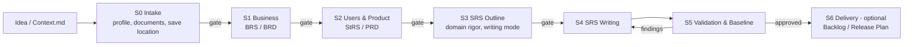

# 🛠️ Requirements Documentation Kit

**English** | [Tiếng Việt](README.vi.md)

[](https://www.iso.org/standard/72087.html)
[](https://ears.requirements.org/)
[]()
[](LICENSE)

### Quick Start

Initialize the kit into an `RDK/` folder in your project directory:

```bash
npx requirements-documentation-kit
```

---

## Overview

The **Requirements Documentation Kit** is a standards-based framework for Agent-User requirements engineering. It guides you **step by step from a raw idea to a reviewed set of requirements documents**. You choose the documents per project:

| Layer | Documents | Basis |
| :--- | :--- | :--- |
| Business (why) | **BRS** and/or **BRD** | ISO/IEC/IEEE 29148:2018 (BRS); IIBA BABOK v3 (BRD) |
| Users & product (who needs what) | **StRS** and/or **PRD** (Lean or Standard) | ISO/IEC/IEEE 29148:2018 (StRS); product management practice (PRD) |
| Software (what it shall do) | **SRS** | ISO/IEC/IEEE 29148:2018 |
| Delivery (optional) | **Product Backlog**, **Release Plan** | Scrum Guide 2020, IIBA BABOK v3 |

BRD, PRD, backlog, and release plan are not defined by any ISO standard; the kit says so and grounds them in BABOK and widely published practice.

The kit stays at **requirements analysis**. It does not produce wireframes, API contracts, database schemas, or implementation guides; those belong to design documents, which the requirements reference. Documents are tailored to the **Project Profile** (who builds and approves), the **Tier** (how large the product is), and the **Domain Rigor** of each part of the product (how complex it is). The AI Agent asks whenever it is unsure instead of guessing, and uses EARS rules and a strict status pipeline to prevent requirement drift, ambiguity, and hallucination.

---

## What's New In 2.0

*   **Domain Rigor**: In Stage S3 each requirement domain (for example `AUTH`, `PAY`, `RISK`) gets a level, `Light`, `Standard`, or `Strict`, from eight complexity drivers. Simple domains stay short; domains with formulas, permissions, or legal duties are specified in full. Depth is never limited by page count, team size, or schedule.
*   **Requirements, not design**: The SRS data model stays conceptual and logical (no tables, columns, or keys). Interface requirements drop protocols, timeouts, and retries. Open design questions go into one "Deferred To Design" table.
*   **Each item written once**: Catalogues are indexes, `Light` domains use one requirement table, the traceability matrix is regenerated instead of maintained by hand, and the SRS references PRD features instead of copying them.
*   **Rule tables**: Several checks with the same trigger and response become one requirement with one acceptance criterion per rule.
*   **Meaning-based validation**: New checks for measurement methods of metric-based requirements (data, ground truth, matching rule, computation), minimum content of business rules by category, domain rigor conformance, and a **Premise Sweep** that finds text still stating an assumption a later decision replaced. Reports state whether each check was mechanical or semantic.
*   **Open question answer sheet**: `OQ-Answers.md` collects every open question with options and a recommendation; you write your decisions there and the Agent applies them. You choose in Stage S0 what an empty answer means.
*   **Deprecated Items register**: Retired items leave the document body and are listed as one row each; their IDs are never reused.

> [!IMPORTANT]
> 2.0 changes the SRS structure (`srs_schema_version: "2.0"`). Projects written with 1.x are not migrated automatically. To move a 1.x project to 2.0, ask the Agent to apply the new kit to it as a change request.

---

## Key Features

*   **Idea-to-Requirements Pipeline**: Stages with User-confirmed gates: Intake → Business (BRS/BRD) → Users & Product (StRS/PRD) → SRS Outline → SRS Writing → Validation & Baseline → Delivery (optional).
*   **Choose Your Documents**: Pick BRS, BRD, StRS, PRD, SRS, Backlog, and Release Plan per project; the Agent recommends a set and never writes the same content twice.
*   **Lean Or Standard PRD**: The Agent asks the PRD scope, then whether you want user stories, a backlog, or a release plan; any "yes" gives a Standard PRD.
*   **Profile × Tier × Domain Rigor**: Governance (PERSONAL / TEAM / SME, inspired by ISO/IEC 29110), scale (Tier 0-3), and the complexity of each requirement domain (`Light` / `Standard` / `Strict`) are tailored independently.
*   **Guided Discovery Interview**: The Agent asks 3-5 questions per turn from a standards-mapped question bank, so you don't need a finished brief to start.
*   **Ask-When-Uncertain**: Whenever input is ambiguous, a setting is unclear, or the Agent isn't sure what to do, it asks you, with options and a recommendation, instead of guessing. It never invents dates, estimates, or prices.
*   **Answer Sheet For Open Questions**: Answer all open questions in one file, `OQ-Answers.md`, instead of searching through the documents.
*   **You Choose The Writing Mode**: Write the SRS one section at a time with a review after each (Incremental), or all at once with one review at the end (Full Generation).
*   **Standard-Compliant Architecture**: BRS, StRS, and SRS content per ISO/IEC/IEEE 29148:2018; NFRs classified by ISO/IEC 25010:2023; privacy review based on ISO/IEC 29100.
*   **EARS Syntax**: Clear, atomic "shall" statements that stay verifiable and unambiguous.
*   **Configurable Output Language**: Write documents in English, Vietnamese, or another language; IDs and statuses stay machine-readable.
*   **Built-in Validation**: Micro checks (each requirement), Macro checks (whole document and requirement set), and Discovery checks (BRS, BRD, StRS, PRD), including meaning-based checks and the Premise Sweep.
*   **End-to-End Traceability**: `Business Goal → Stakeholder Need / Feature / User Story → Software Requirement → Acceptance Criterion → Backlog Item → Release`.
*   **Resumable Work**: A per-project state file records the current stage, open questions, domain rigor, and the next step.

---

## Directory Structure

After `npx requirements-documentation-kit`, your project looks like this. Paths inside the kit files (`Agent/...`, `Context/...`, `User/...`) are relative to the `RDK/` folder.

```text
<your-project>/
├── RDK/                            # Installed by npx
│   ├── Agent/                      # AI Agent instructions & workflows
│   │   ├── 01-Core/                # Core contracts, run modes, interaction rules, project profiles
│   │   ├── 02-Discovery/           # Idea intake, interview question bank, BRS/StRS/BRD/PRD rules (S0-S2)
│   │   ├── 03-SRS/                 # SRS tailoring, writing, validation, change control, traceability (S3-S5)
│   │   ├── 04-Delivery/            # Optional backlog & release plan rules (S6)
│   │   └── AGENTS.md               # Master Agent Directive (System Instruction)
│   ├── Context/                    # Inputs and templates
│   │   ├── Context.md.example      # Structured Idea Intake form
│   │   ├── Project-State-Template.md
│   │   ├── BRS-Template.md
│   │   ├── StRS-Template.md
│   │   ├── BRD-Template.md
│   │   ├── PRD-Template.md         # Lean / Standard
│   │   ├── Backlog-Template.md     # Optional
│   │   ├── Release-Plan-Template.md # Optional
│   │   ├── OQ-Answers-Template.md  # Open question answer sheet
│   │   ├── SRS-TOC.md              # Canonical SRS Table of Contents
│   │   └── SRS-Template.md
│   └── User/                       # Guides for Users
│       ├── About.md                # Concepts: BRS, StRS, SRS & kit conventions
│       └── Guide.md                # How to use the kit, profiles, prompts
└── ProjectDocuments/               # Default output (or any folder you choose)
    └── <ProjectName>/
        ├── 00-Project-State.md
        ├── 01-BRS.md / 01-BRD.md
        ├── 02-StRS.md / 02-PRD.md
        ├── 03-SRS.md
        ├── 04-Backlog.md / 04-Release-Plan.md   (optional)
        ├── OQ-Answers.md                        # Your answers to open questions
        ├── Reports/
        └── Change-Requests/
```

| Directory | Description |
| :--- | :--- |
| **`RDK/Agent/`** | Read-only system instructions for AI Agents. `AGENTS.md` is the master prompt. |
| **`RDK/Context/`** | Your idea intake and the document templates. |
| **`RDK/User/`** | Explanatory documentation for Users. |
| **`ProjectDocuments/`** | Default output folder, one subfolder per project. You can choose another location; the Agent writes only there. |

---

## Pipeline & Run Modes

### Idea-to-Requirements Pipeline



Each gate is confirmed by you (or the approver for your profile). The Agent asks questions at every stage when something is unclear.

### Project Profiles

| Profile | Use When | Recommended Documents | Approver |
| :--- | :--- | :--- | :--- |
| **PERSONAL** | You build it alone | Lean PRD + SRS | You |
| **TEAM** | A group builds it (student project, hackathon, internal tool) | PRD + SRS, or BRS + StRS + SRS | Product Owner / Team Lead |
| **SME** | A business or start-up builds it | BRD + PRD + SRS (+ BRS/StRS if required), compliance review | Business Owner / Founder |

Recommendations only: the Agent asks you to confirm or change the set.

### Tier And Domain Rigor

The **Tier** (0 MVP, 1 small, 2 medium, 3 large or regulated) decides which SRS sections exist. It is judged on several factors together: users, features, how complex the features are, external services, platforms, and regulation.

**Domain Rigor** decides how deeply each requirement domain is written. In Stage S3 the Agent checks every domain for eight complexity drivers (rule logic, state lifecycles, layered access, sensitive data, regulatory duties, serious or irreversible consequences, uncertain or AI-based behavior, many input combinations) and recommends a level; you confirm it.

| Level | Typical Domain | How It Is Written |
| :--- | :--- | :--- |
| `Light` | Standard sign-up and login, simple lists | One table of requirements with short acceptance criteria |
| `Standard` | A workflow with a few states | Requirement blocks, main and exception flows, details for calculation, permission, and state rules |
| `Strict` | Pricing, scoring, permissions across tenants, legal duties | Full blocks, formulas and decision tables, every boundary and negative case |

One product can mix all three levels. If you are unsure of any setting, the Agent explains the options and asks.

### The 7 Run Modes

0.  **Discovery Mode**: Guided interview that turns the idea into the business and product documents you chose (Stages S0-S2). Default for new projects.
1.  **Draft / Outline Mode**: Generates the SRS skeleton tailored to profile and tier, proposes the rigor level of each domain, asks whether S4 runs Incremental or Full Generation, then waits for confirmation.
2.  **Incremental Mode (Default once an SRS exists)**: Writes or edits the SRS one section or domain at a time, with a review after each.
3.  **Audit / Validation Mode**: Read-only quality checks; produces reports without changing documents.
4.  **Change Request / Patch Mode**: Localized edits after impact analysis and a Premise Sweep; formality depends on the profile.
5.  **Full Generation Mode**: Writes all remaining SRS sections, section by section, with one review at the end, when you choose it.
6.  **Delivery Mode (optional)**: Builds a product backlog and/or release plan from the PRD and SRS, using only dates and estimates you provide.

---

## Writing Conventions

### EARS Requirement Syntax

| Pattern | Trigger Syntax | Example |
| :--- | :--- | :--- |
| **Ubiquitous** | `The [system] shall [action]...` | The system shall retain audit logs for 365 days. |
| **Event-driven** | `When [event], the [system] shall [action]...` | When the user submits valid credentials, the system shall create an authenticated session. |
| **State-driven** | `While [state], the [system] shall [action]...` | While an account is locked, the system shall reject password login attempts. |
| **Unwanted Behavior** | `If [trigger], then the [system] shall [action]...` | If payment authorization fails, then the system shall display the payment failure reason. |
| **Optional Feature** | `Where [feature is active], the [system] shall [action]...` | Where multi-factor authentication is enabled, the system shall require a verification code. |

Stakeholder requirements (StRS) describe needs, not solutions: *"The Customer shall be able to book an appointment outside opening hours."*

A requirement that uses a statistic (accuracy, recall, a percentile, a rate) also states how it is measured: on which data, against which correct answers, how an output counts as correct, and how the number is calculated.

### Canonical Status Model

Requirements go through a strict lifecycle. **Only the User approver can set `APPROVED`.**

*   `DRAFT`: Created or revised by the Agent, not yet reviewed.
*   `REVIEW`: Under User review / waiting for decision.
*   `APPROVED`: Explicitly accepted by the approver for the profile.
*   `DEPRECATED`: No longer active; removed from the document body and listed in the document's Deprecated Items register. The ID is never reused.

Open questions use `OPEN` and `CLOSED`.

### ID Format

Each item is tracked using a unique identifier: `<TYPE>-<DOMAIN>-<NNN>`
*   `BG-GEN-001` (Business Goal, in the BRS)
*   `STR-BOOK-001` (Stakeholder Requirement, in the StRS or PRD)
*   `US-BOOK-001` (User Story, in the PRD or Backlog)
*   `FR-AUTH-001` (Functional Requirement - Authentication)
*   `NFR-PERF-001` (Non-Functional Requirement - Performance)
*   `BR-ORDER-001` (Business Rule - Ordering)
*   `UC-PAY-001` (Use Case - Payment)
*   `OQ-AUTH-001` (Open Question - Authentication)

---

## Getting Started

### 👥 For Users
1.  **Describe your idea**: Copy `RDK/Context/Context.md.example` to `RDK/Context/Context.md`. Only Section 1 (the idea) is required; the Agent will ask about the rest.
2.  **Start the Agent**:
    *   *Personal project*: `"Start a new PERSONAL project from Context/Context.md"`
    *   *Team project*: `"Start Discovery for our TEAM project 'LibraryHub'. The approver is our team lead."`
    *   *SME / start-up*: `"Start Discovery for an SME project from Context/Context.md. I need a BRD, a PRD with user stories, and an SRS."`
    *   *Resume*: `"Continue project LibraryHub"`
    *   *Answer open questions*: `"I filled OQ-Answers.md for LibraryHub, apply it"`
    *   *Audit*: `"Validate project LibraryHub and create a validation report"`
3.  **Answer, review, approve**: Answer the Agent's questions (in the conversation or in `OQ-Answers.md`), confirm the rigor level of each domain in Stage S3, review each document at its gate, and approve explicitly (for example, `"Approve BRD v0.3"`).

See [`User/Guide.md`](User/Guide.md) for profiles, tiers, domain rigor, language options, and more prompts.

### 🤖 For AI Agents
1.  Always read the Master Agent Directive in [`Agent/AGENTS.md`](Agent/AGENTS.md) upon bootstrapping.
2.  Find and read the project's `00-Project-State.md` first (default `ProjectDocuments/<ProjectName>/`), then follow the reading sequence in Section 3 of `AGENTS.md`.
3.  Ask whenever you are uncertain; never infer the profile, tier, domain rigor, language, document set, or save location, and never invent dates or estimates.
4.  Write only inside the confirmed output location and protect `APPROVED` content.

---

> [!TIP]
> **Pro Tip:** Run **Audit / Validation Mode** before baselining an SRS. It checks for unresolved TBDs, duplicate IDs, broken traceability links, missing measurement methods, and text that still states a replaced assumption.

> [!NOTE]
> **Standards status:** BRS, StRS, and SRS follow ISO/IEC/IEEE 29148:2018. BRD, PRD, backlog, and release plan have no ISO standard; the kit bases them on IIBA BABOK v3, the Scrum Guide, and widely published product management practice. See [`User/Guide.md`](User/Guide.md) Section 16.
