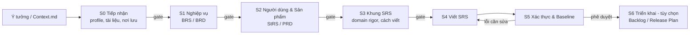

# 🛠️ Bộ Công Cụ Tài Liệu Hóa Yêu Cầu (Requirements Documentation Kit)

[English](README.md) | **Tiếng Việt**

[](https://www.iso.org/standard/72087.html)
[](https://ears.requirements.org/)
[]()
[](LICENSE)

### Bắt Đầu Nhanh

Cài bộ công cụ vào thư mục `RDK/` trong dự án của bạn:

```bash
npx requirements-documentation-kit
```

---

## Tổng Quan

**Requirements Documentation Kit** là bộ công cụ chuẩn hóa cho quy trình kỹ nghệ yêu cầu có sự phối hợp giữa con người (User) và AI (Agent). Bộ công cụ dẫn bạn **từng bước, từ một ý tưởng thô đến một bộ tài liệu yêu cầu đã được rà soát**. Bạn tự chọn những tài liệu cần cho từng dự án:

| Tầng | Tài liệu | Cơ sở |
| :--- | :--- | :--- |
| Nghiệp vụ (vì sao) | **BRS** và/hoặc **BRD** | ISO/IEC/IEEE 29148:2018 (BRS); IIBA BABOK v3 (BRD) |
| Người dùng & sản phẩm (ai cần gì) | **StRS** và/hoặc **PRD** (Lean hoặc Standard) | ISO/IEC/IEEE 29148:2018 (StRS); thực hành product management (PRD) |
| Phần mềm (phải làm gì) | **SRS** | ISO/IEC/IEEE 29148:2018 |
| Triển khai (tùy chọn) | **Product Backlog**, **Release Plan** | Scrum Guide 2020, IIBA BABOK v3 |

BRD, PRD, backlog và release plan không có tiêu chuẩn ISO nào định nghĩa. Kit nói rõ điều này và dựa chúng trên BABOK cùng các thực hành phổ biến.

Kit chỉ làm **phân tích yêu cầu**. Kit không tạo wireframe, API contract, schema cơ sở dữ liệu hay hướng dẫn triển khai; những thứ đó thuộc tài liệu thiết kế, và tài liệu yêu cầu chỉ tham chiếu tới chúng. Tài liệu được điều chỉnh theo **Project Profile** (ai làm và ai duyệt), **Tier** (sản phẩm lớn đến đâu) và **Domain Rigor** của từng phần sản phẩm (phần đó phức tạp đến đâu). AI Agent sẽ hỏi bạn mỗi khi chưa chắc chắn thay vì tự đoán. Agent dùng quy tắc EARS và quy trình trạng thái chặt chẽ để ngăn yêu cầu bị trôi lệch, mơ hồ hoặc bịa đặt (hallucination).

---

## Có Gì Mới Ở Bản 2.0

*   **Domain Rigor**: Ở bước S3, mỗi domain yêu cầu (ví dụ `AUTH`, `PAY`, `RISK`) được đặt một mức `Light`, `Standard` hoặc `Strict` dựa trên tám yếu tố phức tạp. Domain đơn giản được viết gọn; domain có công thức, phân quyền hay nghĩa vụ pháp lý được đặc tả đầy đủ. Độ sâu không bao giờ bị giới hạn theo số trang, số người hay thời gian.
*   **Yêu cầu, không phải thiết kế**: Mô hình dữ liệu trong SRS dừng ở mức khái niệm và logic (không có bảng, cột, khóa). Yêu cầu giao tiếp bỏ protocol, timeout, retry. Các câu hỏi để dành cho thiết kế được gom vào một bảng "Deferred To Design".
*   **Mỗi nội dung chỉ viết một lần**: Catalogue chỉ là chỉ mục, domain `Light` dùng một bảng yêu cầu, ma trận truy vết được sinh lại thay vì sửa tay, và SRS tham chiếu feature của PRD thay vì chép lại.
*   **Bảng luật**: Nhiều kiểm tra có cùng điều kiện kích hoạt và cùng cách phản hồi được gộp thành một yêu cầu, mỗi luật là một tiêu chí nghiệm thu.
*   **Kiểm tra theo nghĩa**: Thêm các kiểm tra về phương pháp đo của yêu cầu có chỉ số (dữ liệu, chuẩn đúng, luật so khớp, cách tính), nội dung tối thiểu của business rule theo loại, mức độ đúng với rigor của domain, và **Premise Sweep** để tìm những chỗ còn diễn đạt một giả định đã bị quyết định sau thay thế. Báo cáo ghi rõ mỗi kiểm tra là kiểm tra máy móc hay kiểm tra theo nghĩa.
*   **Phiếu trả lời câu hỏi mở**: `OQ-Answers.md` gom mọi câu hỏi mở kèm lựa chọn và đề xuất; bạn ghi quyết định vào đó và Agent áp dụng. Ở bước S0 bạn chọn cách hiểu khi để trống câu trả lời.
*   **Sổ Deprecated Items**: Mục bị loại bỏ được rút khỏi thân tài liệu và ghi thành một dòng trong sổ; ID không bao giờ được dùng lại.

> [!IMPORTANT]
> Bản 2.0 thay đổi cấu trúc SRS (`srs_schema_version: "2.0"`). Dự án viết bằng bản 1.x không được chuyển đổi tự động. Muốn đưa một dự án 1.x lên 2.0, hãy yêu cầu Agent áp dụng kit mới cho dự án đó qua một change request.

---

## Tính Năng Nổi Bật

*   **Quy trình từ ý tưởng đến bộ tài liệu yêu cầu**: Các bước có cổng (gate) do con người xác nhận: Intake → Nghiệp vụ (BRS/BRD) → Người dùng & Sản phẩm (StRS/PRD) → Khung SRS → Viết SRS → Xác thực & Chốt baseline → Triển khai (tùy chọn).
*   **Tự chọn bộ tài liệu**: Chọn BRS, BRD, StRS, PRD, SRS, Backlog, Release Plan cho từng dự án. Agent gợi ý một bộ và không bao giờ viết cùng một nội dung hai lần.
*   **PRD Lean hoặc Standard**: Agent hỏi phạm vi PRD, sau đó hỏi bạn có muốn user stories, backlog hay release plan không. Chỉ cần một câu "có" là làm Standard PRD.
*   **Profile × Tier × Domain Rigor**: Mức quản trị (PERSONAL / TEAM / SME, dựa trên tinh thần ISO/IEC 29110), quy mô (Tier 0-3) và độ phức tạp của từng domain yêu cầu (`Light` / `Standard` / `Strict`) được điều chỉnh độc lập với nhau.
*   **Phỏng vấn khám phá có hướng dẫn**: Mỗi lượt Agent hỏi 3-5 câu, lấy từ bộ câu hỏi đã ánh xạ theo tiêu chuẩn. Bạn không cần có sẵn tài liệu mô tả hoàn chỉnh mới bắt đầu được.
*   **Không chắc thì hỏi (Ask-When-Uncertain)**: Khi đầu vào mơ hồ, một thiết lập chưa rõ, hoặc Agent không biết làm gì tiếp, Agent sẽ hỏi bạn kèm các lựa chọn và đề xuất, thay vì tự đoán. Agent không bao giờ tự đặt ngày, ước lượng hay giá.
*   **Phiếu trả lời câu hỏi mở**: Trả lời mọi câu hỏi mở trong một file, `OQ-Answers.md`, thay vì phải lục trong từng tài liệu.
*   **Bạn chọn cách viết**: Viết SRS từng phần và duyệt sau mỗi phần (Incremental), hoặc viết hết rồi duyệt một lần ở cuối (Full Generation).
*   **Kiến trúc chuẩn hóa**: Nội dung BRS, StRS, SRS theo ISO/IEC/IEEE 29148:2018; yêu cầu phi chức năng phân loại theo ISO/IEC 25010:2023; rà soát quyền riêng tư dựa trên ISO/IEC 29100.
*   **Cú pháp EARS**: Câu yêu cầu "phải" (shall) rõ ràng, đơn nhất, kiểm chứng được.
*   **Chọn ngôn ngữ đầu ra**: Viết tài liệu bằng tiếng Anh, tiếng Việt hoặc ngôn ngữ khác. ID và trạng thái vẫn giữ dạng máy đọc được.
*   **Xác thực tích hợp**: Kiểm tra Micro (từng yêu cầu), Macro (toàn tài liệu và tập yêu cầu) và kiểm tra Discovery (BRS, BRD, StRS, PRD), gồm cả kiểm tra theo nghĩa và Premise Sweep.
*   **Truy vết xuyên suốt**: `Mục tiêu nghiệp vụ → Nhu cầu / Tính năng / User Story → Yêu cầu phần mềm → Tiêu chí chấp nhận → Backlog → Release`.
*   **Làm tiếp được bất cứ lúc nào**: Mỗi dự án có file trạng thái ghi lại bước hiện tại, các câu hỏi còn mở, mức rigor của từng domain và bước tiếp theo.

---

## Cấu Trúc Thư Mục

Sau khi chạy `npx requirements-documentation-kit`, dự án của bạn có dạng như sau. Các đường dẫn trong file của kit (`Agent/...`, `Context/...`, `User/...`) được tính từ thư mục `RDK/`.

```text
<du-an-cua-ban>/
├── RDK/                            # Được cài bởi npx
│   ├── Agent/                      # Hướng dẫn & quy trình cho AI Agent
│   │   ├── 01-Core/                # Quy tắc cốt lõi, chế độ vận hành, tương tác, project profile
│   │   ├── 02-Discovery/           # Tiếp nhận ý tưởng, bộ câu hỏi phỏng vấn, quy tắc BRS/StRS/BRD/PRD (S0-S2)
│   │   ├── 03-SRS/                 # Điều chỉnh, viết, xác thực SRS, kiểm soát thay đổi, truy vết (S3-S5)
│   │   ├── 04-Delivery/            # Quy tắc backlog & release plan, tùy chọn (S6)
│   │   └── AGENTS.md               # Chỉ thị Master Agent (System Instruction)
│   ├── Context/                    # Đầu vào và biểu mẫu
│   │   ├── Context.md.example      # Mẫu tiếp nhận ý tưởng có cấu trúc
│   │   ├── Project-State-Template.md
│   │   ├── BRS-Template.md
│   │   ├── StRS-Template.md
│   │   ├── BRD-Template.md
│   │   ├── PRD-Template.md         # Lean / Standard
│   │   ├── Backlog-Template.md     # Tùy chọn
│   │   ├── Release-Plan-Template.md # Tùy chọn
│   │   ├── OQ-Answers-Template.md  # Phiếu trả lời câu hỏi mở
│   │   ├── SRS-TOC.md              # Mục lục SRS chuẩn
│   │   └── SRS-Template.md
│   └── User/                       # Tài liệu hướng dẫn cho con người
│       ├── About.md                # Khái niệm: BRS, StRS, SRS & quy ước
│       └── Guide.md                # Cách dùng, profile, câu lệnh mẫu
└── ProjectDocuments/               # Đầu ra mặc định (hoặc thư mục bạn chọn)
    └── <ProjectName>/
        ├── 00-Project-State.md
        ├── 01-BRS.md / 01-BRD.md
        ├── 02-StRS.md / 02-PRD.md
        ├── 03-SRS.md
        ├── 04-Backlog.md / 04-Release-Plan.md   (tùy chọn)
        ├── OQ-Answers.md                        # Phiếu trả lời câu hỏi mở
        ├── Reports/
        └── Change-Requests/
```

| Thư mục | Mô tả |
| :--- | :--- |
| **`RDK/Agent/`** | Chỉ thị hệ thống (chỉ đọc) cho AI Agent. `AGENTS.md` là system prompt chính. |
| **`RDK/Context/`** | Mô tả ý tưởng của bạn và các biểu mẫu tài liệu. |
| **`RDK/User/`** | Tài liệu giải thích dành cho con người. |
| **`ProjectDocuments/`** | Thư mục đầu ra mặc định, mỗi dự án một thư mục con. Bạn có thể chọn nơi khác; Agent chỉ ghi vào đó. |

---

## Quy Trình & Các Chế Độ Vận Hành

### Quy trình từ ý tưởng đến bộ tài liệu yêu cầu



Mỗi cổng (gate) do bạn hoặc người phê duyệt của profile xác nhận. Ở mọi bước, Agent sẽ hỏi khi có điều chưa rõ.

### Project Profile

| Profile | Khi nào dùng | Bộ tài liệu gợi ý | Người phê duyệt |
| :--- | :--- | :--- | :--- |
| **PERSONAL** | Bạn tự làm một mình | Lean PRD + SRS | Chính bạn |
| **TEAM** | Một nhóm cùng làm (đồ án, hackathon, công cụ nội bộ) | PRD + SRS, hoặc BRS + StRS + SRS | Product Owner / Trưởng nhóm |
| **SME** | Doanh nghiệp hoặc startup làm sản phẩm | BRD + PRD + SRS (+ BRS/StRS nếu được yêu cầu), rà soát tuân thủ | Chủ doanh nghiệp / Founder |

Đây chỉ là gợi ý: Agent sẽ hỏi bạn xác nhận hoặc thay đổi bộ tài liệu.

### Tier Và Domain Rigor

**Tier** (0 MVP, 1 nhỏ, 2 trung bình, 3 lớn hoặc có ràng buộc pháp lý) quyết định SRS có những phần nào. Tier được xét trên nhiều yếu tố cùng lúc: người dùng, số feature, độ phức tạp của feature, dịch vụ bên ngoài, nền tảng và pháp lý.

**Domain Rigor** quyết định mỗi domain yêu cầu được viết sâu đến đâu. Ở bước S3, Agent kiểm tra từng domain theo tám yếu tố phức tạp (logic quy tắc, vòng đời trạng thái, phân quyền nhiều tầng, dữ liệu nhạy cảm, nghĩa vụ pháp lý, hậu quả nghiêm trọng hoặc không đảo ngược được, hành vi không chắc chắn hoặc dựa trên AI, nhiều tổ hợp đầu vào) rồi đề xuất một mức; bạn xác nhận.

| Mức | Domain điển hình | Cách viết |
| :--- | :--- | :--- |
| `Light` | Đăng ký, đăng nhập thông thường, danh sách đơn giản | Một bảng yêu cầu với tiêu chí nghiệm thu ngắn |
| `Standard` | Một luồng nghiệp vụ có vài trạng thái | Block yêu cầu, luồng chính và luồng ngoại lệ, chi tiết cho quy tắc tính toán, phân quyền, trạng thái |
| `Strict` | Định giá, chấm điểm, phân quyền giữa nhiều không gian, nghĩa vụ pháp lý | Block đầy đủ, công thức và bảng quyết định, mọi giá trị biên và trường hợp phủ định |

Một sản phẩm có thể có cả ba mức. Nếu bạn chưa chắc về thiết lập nào, Agent sẽ giải thích các lựa chọn và hỏi bạn.

### 7 Chế Độ Vận Hành

0.  **Discovery Mode (Khám phá)**: Phỏng vấn có hướng dẫn để biến ý tưởng thành các tài liệu nghiệp vụ và sản phẩm bạn đã chọn (bước S0-S2). Là chế độ mặc định khi bắt đầu dự án mới.
1.  **Draft / Outline Mode (Phác thảo)**: Tạo khung SRS theo profile và tier, đề xuất mức rigor cho từng domain, hỏi bước S4 chạy Incremental hay Full Generation, rồi chờ bạn xác nhận.
2.  **Incremental Mode (Viết tăng dần, mặc định khi đã có SRS)**: Viết hoặc sửa SRS từng phần hoặc từng domain, duyệt sau mỗi phần.
3.  **Audit / Validation Mode (Kiểm tra)**: Chỉ đọc; kiểm tra chất lượng và tạo báo cáo mà không sửa tài liệu.
4.  **Change Request / Patch Mode (Thay đổi)**: Sửa cục bộ sau khi phân tích tác động và Premise Sweep. Mức độ chặt chẽ tùy theo profile.
5.  **Full Generation Mode (Tạo toàn bộ)**: Viết hết các phần SRS còn lại theo từng phần và duyệt một lần ở cuối, khi bạn chọn chế độ này.
6.  **Delivery Mode (Triển khai, tùy chọn)**: Lập product backlog và/hoặc release plan từ PRD và SRS, chỉ dùng ngày và ước lượng do bạn cung cấp.

---

## Quy Ước Viết Yêu Cầu

### Cú Pháp EARS

Với tiếng Việt, từ khóa bắt buộc là **"phải"** (tương đương *shall*). Không dùng "sẽ", vì "sẽ" chỉ tương đương *will* và mang nghĩa yếu hơn.

| Dạng yêu cầu | Cú pháp | Ví dụ |
| :--- | :--- | :--- |
| **Ubiquitous**<br>*(Luôn áp dụng)* | `Hệ thống phải [hành động]...` | Hệ thống phải lưu nhật ký kiểm toán trong 365 ngày. |
| **Event-driven**<br>*(Theo sự kiện)* | `Khi [sự kiện], hệ thống phải [hành động]...` | Khi người dùng gửi thông tin đăng nhập hợp lệ, hệ thống phải tạo một phiên đã xác thực. |
| **State-driven**<br>*(Theo trạng thái)* | `Trong khi [trạng thái], hệ thống phải [hành động]...` | Trong khi tài khoản bị khóa, hệ thống phải từ chối các lần đăng nhập bằng mật khẩu. |
| **Unwanted Behavior**<br>*(Xử lý lỗi/ngoại lệ)* | `Nếu [điều kiện], thì hệ thống phải [hành động]...` | Nếu xác thực thanh toán thất bại, thì hệ thống phải hiển thị lý do thất bại. |
| **Optional Feature**<br>*(Tính năng tùy chọn)* | `Ở nơi [tính năng được bật], hệ thống phải [hành động]...` | Ở nơi xác thực đa yếu tố được bật, hệ thống phải yêu cầu mã xác minh. |

Yêu cầu của bên liên quan (StRS) mô tả nhu cầu, không mô tả giải pháp: *"Khách hàng phải có thể đặt lịch hẹn ngoài giờ mở cửa."*

Yêu cầu có dùng chỉ số thống kê (độ chính xác, recall, percentile, tỷ lệ) phải nêu cả cách đo: đo trên dữ liệu nào, so với đáp án đúng nào, khi nào một kết quả được tính là đúng, và con số được tính ra sao.

### Mô Hình Trạng Thái Yêu Cầu

**Chỉ người phê duyệt (con người) mới được đặt trạng thái `APPROVED`.**

*   `DRAFT`: Agent tạo mới hoặc vừa sửa, chưa được rà soát.
*   `REVIEW`: Đang chờ con người rà soát hoặc ra quyết định.
*   `APPROVED`: Được người phê duyệt của profile chấp thuận chính thức.
*   `DEPRECATED`: Không còn hiệu lực; được rút khỏi thân tài liệu và ghi vào sổ Deprecated Items của tài liệu. ID không bao giờ được dùng lại.

Câu hỏi mở dùng hai trạng thái `OPEN` và `CLOSED`.

### Định Dạng Mã (ID)

Mỗi mục được theo dõi bằng mã duy nhất: `<TYPE>-<DOMAIN>-<NNN>`
*   `BG-GEN-001` (Mục tiêu nghiệp vụ, trong BRS)
*   `STR-BOOK-001` (Yêu cầu của bên liên quan, trong StRS hoặc PRD)
*   `US-BOOK-001` (User Story, trong PRD hoặc Backlog)
*   `FR-AUTH-001` (Yêu cầu chức năng - Xác thực)
*   `NFR-PERF-001` (Yêu cầu phi chức năng - Hiệu năng)
*   `BR-ORDER-001` (Quy tắc nghiệp vụ - Đặt hàng)
*   `UC-PAY-001` (Use Case - Thanh toán)
*   `OQ-AUTH-001` (Câu hỏi mở - Xác thực)

---

## Hướng Dẫn Bắt Đầu

### 👥 Dành cho Người dùng
1.  **Mô tả ý tưởng**: Sao chép `RDK/Context/Context.md.example` thành `RDK/Context/Context.md`. Bạn chỉ cần điền Mục 1 (ý tưởng); phần còn lại Agent sẽ hỏi dần.
2.  **Khởi động Agent**:
    *   *Dự án cá nhân*: `"Start a new PERSONAL project from Context/Context.md. Write documents in Vietnamese."`
    *   *Dự án nhóm*: `"Start Discovery for our TEAM project 'LibraryHub'. The approver is our team lead."`
    *   *SME / startup*: `"Start Discovery for an SME project from Context/Context.md. I need a BRD, a PRD with user stories, and an SRS."`
    *   *Làm tiếp*: `"Continue project LibraryHub"`
    *   *Trả lời câu hỏi mở*: `"Tôi đã điền OQ-Answers.md của LibraryHub, hãy áp dụng"`
    *   *Kiểm tra*: `"Validate project LibraryHub and create a validation report"`
3.  **Trả lời, rà soát, phê duyệt**: Trả lời câu hỏi của Agent (trong cuộc trò chuyện hoặc trong `OQ-Answers.md`), xác nhận mức rigor của từng domain ở bước S3, rà soát từng tài liệu ở mỗi cổng, và phê duyệt một cách rõ ràng (ví dụ: `"Approve BRD v0.3"`).

Xem [`User/Guide.md`](User/Guide.md) để biết thêm về profile, tier, domain rigor, ngôn ngữ và các câu lệnh mẫu khác.

### 🤖 Dành cho AI Agent
1.  Luôn đọc Master Agent Directive trong [`Agent/AGENTS.md`](Agent/AGENTS.md) khi bắt đầu phiên làm việc.
2.  Tìm và đọc `00-Project-State.md` của dự án trước (mặc định trong `ProjectDocuments/<ProjectName>/`), sau đó làm theo thứ tự đọc ở Mục 3 của `AGENTS.md`.
3.  Hỏi mỗi khi chưa chắc chắn; không bao giờ tự suy ra profile, tier, domain rigor, ngôn ngữ, bộ tài liệu hay nơi lưu, và không bao giờ tự đặt ngày hay ước lượng.
4.  Chỉ ghi trong thư mục đầu ra đã được xác nhận và bảo vệ nội dung đã `APPROVED`.

---

> [!TIP]
> **Mẹo:** Chạy **Audit / Validation Mode** trước khi chốt baseline SRS. Chế độ này kiểm tra TBD chưa xử lý, ID trùng, liên kết truy vết bị đứt, yêu cầu thiếu phương pháp đo, và những chỗ còn diễn đạt một giả định đã bị thay thế.

> [!NOTE]
> **Tình trạng tiêu chuẩn:** BRS, StRS và SRS theo ISO/IEC/IEEE 29148:2018. BRD, PRD, backlog và release plan không có tiêu chuẩn ISO; kit dựa chúng trên IIBA BABOK v3, Scrum Guide và các thực hành product management phổ biến. Xem [`User/Guide.md`](User/Guide.md) Mục 16.
